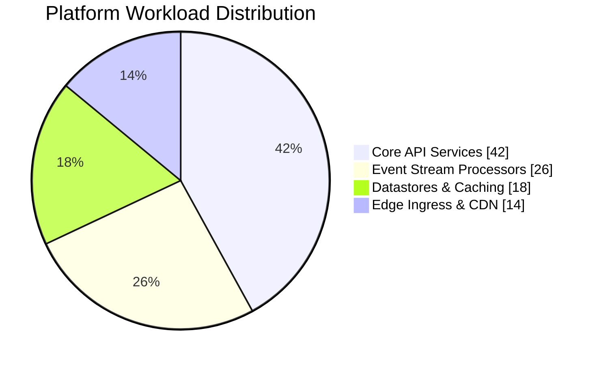
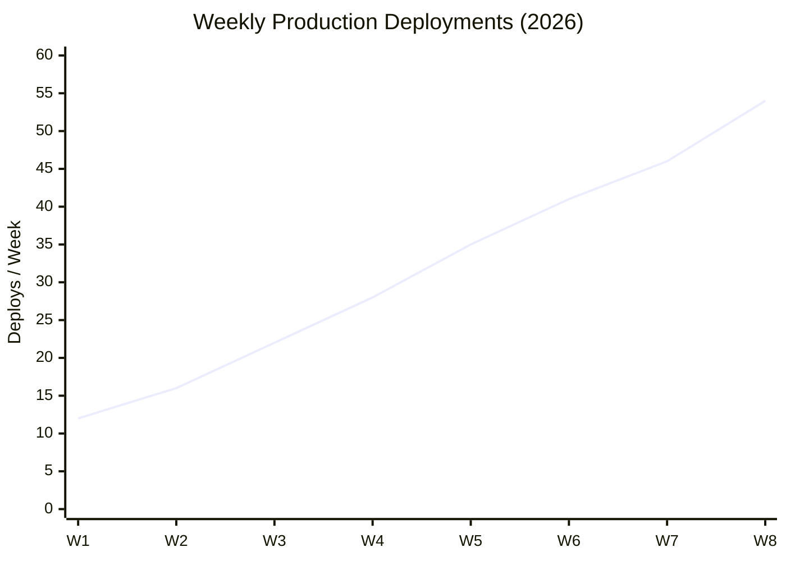
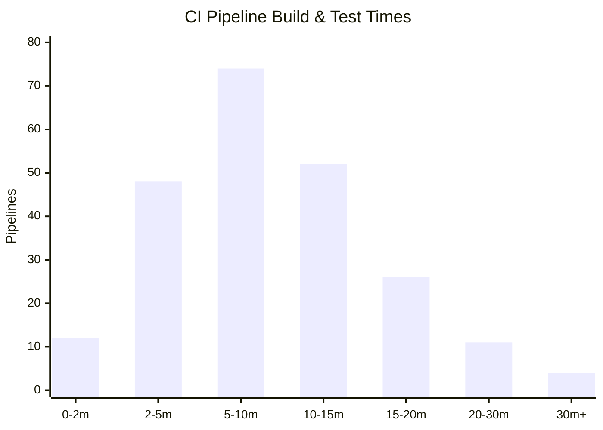

<!-- slide -->

## Platform today

Our services are reliable, but deployment speed is constrained by shared dependencies.

<!-- slide -->

## Design priorities

<!-- col 2:1:2 -->

### Reliability

- Clear service ownership
- Safe, reversible releases
- Measured recovery objectives

<!-- col-sep -->

### →

Independent deploys

<!-- col-sep -->

### Developer experience

- One local workflow
- Fast feedback loops
- Useful operational defaults

<!-- /col -->

<!-- slide -->

## Workload Distribution

<!-- col 3:2 none -->

<!-- col-sep -->

### Resource allocation

- **Core APIs**: Compute-heavy workloads requiring dedicated autoscaling
- **Event streams**: High throughput messaging pipelines
- **Datastores**: Low latency distributed cache & replica sets

<!-- quote: blue -->
> Decoupling async workers freed 15% core compute headroom in Q3.

<!-- /col -->

<!-- slide -->

## Deployment Velocity Trend

Weekly production release cadence following service contract decoupling:

<!-- quote: green -->
> Production deployment frequency grew **4.5×** with automated canary validations.

<!-- slide -->

## Build Duration Distribution

Histogram of CI pipeline build and test durations across 250+ services:

<!-- quote: yellow -->
> **72%** of pipelines complete under 10 minutes; targeting sub-5m for core services in Q1.

<!-- slide -->

## Next 90 days

| Milestone | Outcome |
| --- | --- |
| Service contracts | Explicit, versioned boundaries |
| Deployment templates | Repeatable releases |
| Observability baseline | Faster diagnosis |

<!-- slide -->

## Decision

Start with the three highest-change services, validate the approach, then expand deliberately.
